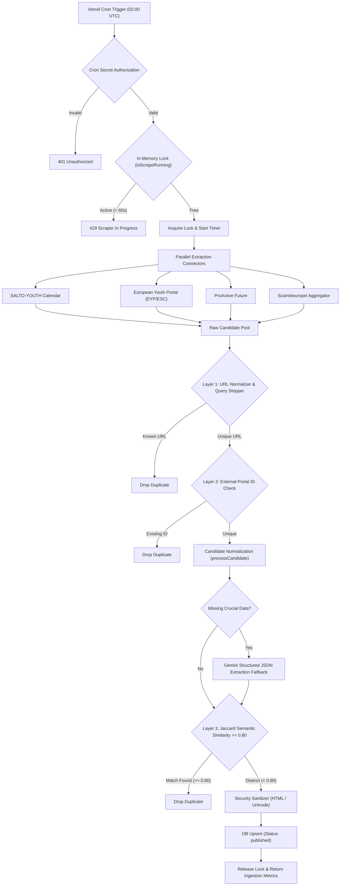
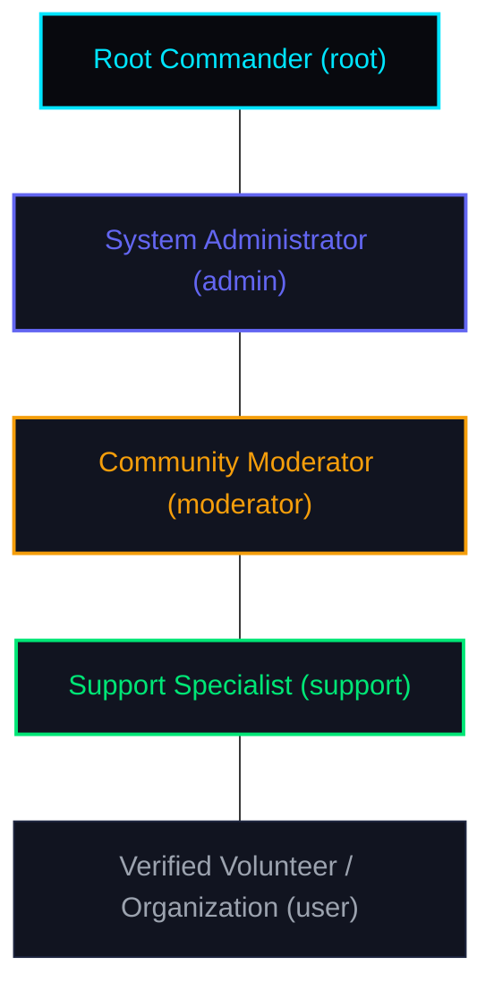

# EuroNova Administrator Manual: Scraper Engine, True Trust Economics & Staff Hierarchy

**EuroNova Platform Operations & Systems Governance Manual**  
*Document Version:* 1.0.0  
*Architecture Target:* Next.js 15 (App Router), Supabase PostgreSQL, Vercel Serverless  
*Audience:* System Administrators, Lead Developers, Community Directors, Compliance Auditors  

---

## Table of Contents
1. [Section 1: Auto-Scraper Engine Internals](#section-1-auto-scraper-engine-internals)
   - [1.1 Architectural Overview & Data Ingestion Flow](#11-architectural-overview--data-ingestion-flow)
   - [1.2 Primary Ingestion Sources](#12-primary-ingestion-sources)
   - [1.3 Normalization Pipeline (`processCandidate`)](#13-normalization-pipeline-processcandidate)
   - [1.4 The 3-Layer Deduplication Shield](#14-the-3-layer-deduplication-shield)
   - [1.5 In-Memory Concurrency Lock & Serverless Execution Guard](#15-in-memory-concurrency-lock--serverless-execution-guard)
   - [1.6 Staggered Background Cron Architecture](#16-staggered-background-cron-architecture)
2. [Section 2: Mathematical Economy of the True Trust Protocol & 50-Tier Gamification](#section-2-mathematical-economy-of-the-true-trust-protocol--50-tier-gamification)
   - [2.1 The True Trust Protocol Foundations](#21-the-true-trust-protocol-foundations)
   - [2.2 Trust Score Tiers & Multipliers](#22-trust-score-tiers--multipliers)
   - [2.3 Trust Adjustment Vectors & Severe Infraction Floor](#23-trust-adjustment-vectors--severe-infraction-floor)
   - [2.4 Base XP Value Matrix & Anti-Spam Velocity Caps](#24-base-xp-value-matrix--anti-spam-velocity-caps)
   - [2.5 The 50-Tier Progression Mathematics](#25-the-50-tier-progression-mathematics)
   - [2.6 Critical Functional Access Gates](#26-critical-functional-access-gates)
3. [Section 3: 4-Tier Staff Hierarchy & Moderation Operations](#section-3-4-tier-staff-hierarchy--moderation-operations)
   - [3.1 Staff Role Hierarchy Overview](#31-staff-role-hierarchy-overview)
   - [3.2 Granular Permission Matrix (`ROLE_PERMISSIONS`)](#32-granular-permission-matrix-role_permissions)
   - [3.3 Disciplinary Actions & Protective Shield Guards](#33-disciplinary-actions--protective-shield-guards)
   - [3.4 Asymmetric Data Privacy & Sensitive Data Toggle](#34-asymmetric-data-privacy--sensitive-data-toggle)
   - [3.5 Quarantine Tray Incident Logging](#35-quarantine-tray-incident-logging)
   - [3.6 Staff Live Chat Hub & Channel Access Control List](#36-staff-live-chat-hub--channel-access-control-list)

---

## Section 1: Auto-Scraper Engine Internals

The EuroNova Auto-Scraper is an autonomous, serverless-optimized extraction and curation pipeline designed to ingest verified youth opportunities from official European institutions, normalize unstructured metadata into canonical schemas, prevent duplicate mission entries, and publish high-quality listings without operator intervention.

### 1.1 Architectural Overview & Data Ingestion Flow

The pipeline executes synchronously on Vercel Serverless Functions under a strict 60-second execution envelope (`maxDuration = 60`).



### 1.2 Primary Ingestion Sources

The scraper connects directly to four authoritative European youth mobility feeds:

1. **SALTO-YOUTH European Training Calendar (`fetchSaltoProjects`)**:
   - Ingests structured Training Courses (TC), Seminars (SE), and Partnership Building Activities (PBA).
   - Extracts unique application IDs from URLs matching `/training/[slug].[id]/`.
   - Priority source for adult trainers, youth workers, and Erasmus+ accreditation bodies.

2. **European Youth Portal / European Solidarity Corps (`fetchEypEscProjects`)**:
   - Scrapes official European Commission volunteering placements from `youth.europa.eu/solidarity/placement/`.
   - Captures native ESC program codes (`ESC-50`, `ESC-51`, `ESC-HUM`).
   - Retains 100% verified funding statuses (free accommodation, travel reimbursement, pocket money).

3. **ProActive Future (`fetchProactiveProjects`)**:
   - Pulls Youth Exchanges (YE) and mobility projects from ProActive Future API endpoints.
   - Extracts specific participating country requirements and travel allowances.

4. **Scambieuropei Mobility Aggregator (`fetchYeAggregatorProjects`)**:
   - Ingests localized youth opportunity announcements for European residents.
   - Maps editorial tags to canonical European themes.

### 1.3 Normalization Pipeline (`processCandidate`)

Every candidate extracted from raw HTML or RSS feeds passes through the `processCandidate()` transformation pipeline:

1. **Title Sanitation & Prefix Stripping (`cleanScrapedTitle`)**:
   - Decodes HTML entities (`&amp;`, `&#39;`, `&euro;`, etc.).
   - Strips country prefix brackets: `[ES]`, `[ONLINE]`, `[ESC]`, `[YE]`, `[TC]`.
   - Removes boilerplate prefixes: `"Training Course:"`, `"Youth Exchange - "`, `"Call for Participants:"`, `"Infopack:"`.
   - Strips leading date stamps (e.g., `2026-10-26 - Title`).

2. **Canonical Project Type Resolution (`normalizeErasmusProjectType`)**:
   - Maps raw acronyms into the 8 canonical project types:
     - `YE`: Youth Exchange
     - `TC`: Training Course / TCA / KA153
     - `ESC`: European Solidarity Corps / Volunteering
     - `PBA`: Partnership Building Activity / KA2
     - `VET`: Vocational Education and Training / FP
     - `SV`: Study Visit
     - `SE`: Seminar
     - `CBY`: Capacity Building for Youth

3. **Date Resolution & Deadline Protection (`parseEuropeanDateRange` & `sanitizeTextForDates`)**:
   - Formats varied European dates (`DD/MM/YYYY`, `DD.MM.YYYY`, `Month DD, YYYY`) into ISO standard `YYYY-MM-DD`.
   - **Deadline Shield**: RegEx aggressively identifies and removes application deadlines (`deadline`, `apply by`, `fecha límite`) from the text *before* extracting mobility start and end dates. This guarantees an application closing date is never confused with the actual project departure date.

4. **Canonical Theme Classification (`mapToCanonicalTopics`)**:
   - Maps multilingual keywords (English, Spanish, French, Italian, German) into the 12 platform themes:
     - `environment`, `digital`, `inclusion`, `mental_health`, `arts_culture`, `sports`, `human_rights`, `entrepreneurship`, `civic_participation`, `media_literacy`, `rural_development`, `heritage`.

5. **AI Extraction Fallback (`extractWithAI`)**:
   - If heuristic regex fails to detect dates or destination countries, the raw text is dispatched to Google Gemini (`gemini-1.5-flash` or `gemini-2.0-flash`) with a strict JSON schema prompt to extract `start_date`, `end_date`, `dest_country`, `exact_location`, and `eligible_countries`.

6. **Defensive Security Sanitization**:
   - All text fields are sanitized through `stripDangerousHtml()` to remove `<script>`, `<iframe>`, `javascript:`, and nested style injections.
   - Unicode text is sanitized via `sanitizeUnicode()` to normalize non-standard symbols and emojis.

### 1.4 The 3-Layer Deduplication Shield

To prevent duplicate project entries when the same Erasmus+ mission is posted across multiple portals or syndicated feeds, EuroNova executes a 3-layer deduplication filter:

```
[Incoming Scraped Candidate]
       │
       ▼
┌────────────────────────────────────────────────────────┐
│ Layer 1: Canonical URL Normalization                   │
│ • Strips tracking params (utm_*, fbclid, gclid, etc.)  │
│ • Forces https://, lowercases domain, removes #frag    │
│ • Database check: WHERE official_url = canonicalUrl    │
└────────────────────────────────────────────────────────┘
       │ (Unique URL)
       ▼
┌────────────────────────────────────────────────────────┐
│ Layer 2: External Portal ID / Slug Extraction          │
│ • Salto: salto:12345                                   │
│ • EYP:   eyp:ESC-PLACEMENT-789                         │
│ • Database check against external ID index             │
└────────────────────────────────────────────────────────┘
       │ (Unique External ID)
       ▼
┌────────────────────────────────────────────────────────┐
│ Layer 3: Semantic Content & Title Jaccard Similarity   │
│ • Normalizes title: lowercase, diacritics stripped     │
│ • Filters 50+ multilingual COMMON_STOP_WORDS           │
│ • Jaccard index similarity >= 0.80 against country     │
│ • If Similarity >= 0.80: REJECT AS DUPLICATE           │
└────────────────────────────────────────────────────────┘
       │ (Unique Content)
       ▼
[Insert into Database]
```

#### Layer 1: Canonical URL Stripper (`normalizeOfficialUrl`)
- Strips URL query tracking prefixes: `utm_`, `fbclid`, `gclid`, `ref`, `mc_cid`, `mc_eid`, `_ga`, `_gl`, `msclkid`, `source`.
- Forces HTTPS, lowercases domain name, strips default ports (`:80`, `:443`), removes URL hash fragments (`#`), and strips trailing slashes.
- Sorts remaining non-tracking query parameters alphabetically.

#### Layer 2: External Portal ID Resolution (`extractPortalExternalId`)
- Resolves official system identifiers from known European portals:
  - `salto-youth.net/training/...12345/` $\rightarrow$ `salto:12345`
  - `youth.europa.eu/solidarity/placement/12345_en` $\rightarrow$ `eyp:12345`
  - `proactivefuture.eu/?o=987` $\rightarrow$ `proactive:987`
  - `scambieuropei.info/slug-name/` $\rightarrow$ `scambi:slug-name`

#### Layer 3: Semantic Content Fingerprinting & Jaccard Similarity
When URL and External ID checks pass, the candidate is compared against existing missions in the same `dest_country`:
1. **Title Tokenization**: The candidate title is lowercased, diacritics removed (`NFD`), non-alphanumeric characters stripped, and split into distinct tokens.
2. **Stop Word Filtering**: Tokens are filtered against `COMMON_STOP_WORDS` (contains over 50 structural and multilingual stopwords such as `youth`, `exchange`, `training`, `course`, `erasmus`, `intercambio`, `juvenil`, `formacion`, `scambio`, `voluntariado`, `pour`, `dans`, `der`, `die`, `das`, `infopack`, `spain`, etc.).
3. **Jaccard Token Similarity Index**:
   $$J(A, B) = \frac{|Tokens_A \cap Tokens_B|}{|Tokens_A \cup Tokens_B|}$$
4. **Rejection Threshold**: If $J(A, B) \ge 0.80$, the candidate is classified as a semantic duplicate and dropped.

### 1.5 In-Memory Concurrency Lock & Serverless Execution Guard

Because Vercel serverless function instances can experience overlapping triggers during retries or simultaneous manual administrator invocations, an in-memory execution lock is enforced:

- `isScrapeRunning = true`
- `scrapeLockTimestamp = Date.now()`
- `SCRAPE_LOCK_TIMEOUT_MS = 60000` (60 seconds)

If a secondary request arrives while `isScrapeRunning === true` and the elapsed time is less than 60 seconds, the endpoint immediately aborts and returns an HTTP `429 Too Many Requests`:
```json
{
  "error": "Scraper is already running. Please wait for the current extraction cycle to finish.",
  "status": "locked"
}
```
If the lock exceeds 60 seconds (due to an unhandled crash or timeout), the lock is automatically reclaimed.

### 1.6 Staggered Background Cron Architecture

To prevent CPU and RAM contention on serverless nodes and avoid database deadlocks, the four platform background crons are strictly staggered across morning hours (UTC) in `vercel.json`:

| Schedule (UTC) | Endpoint | Purpose | Batch Limit | Timeout |
| :--- | :--- | :--- | :--- | :--- |
| **`02:00`** | `/api/cron/scrape` | Ingests new missions from official feeds via Auto-Scraper | — | 60s |
| **`03:00`** | `/api/cron/archive` | Updates projects with `end_date < CURRENT_DATE` to `archived` | 100 rows | 60s |
| **`04:00`** | `/api/cron/purge-logs` | Deletes `telemetry_logs` > 30 days and resolved `project_reports` > 90 days | 100 rows | 60s |
| **`05:00`** | `/api/cron/inactivity-purge` | GDPR cascade purge of unverified users inactive for > 180 days with 0 missions | 20 users | 60s |

All cron endpoints require the `Authorization: Bearer <CRON_SECRET>` header, verified via constant-time comparison in `lib/cronAuth.ts`.

---

## Section 2: Mathematical Economy of the True Trust Protocol & 50-Tier Gamification

EuroNova does not rely on arbitrary user voting or paid promotion. Platform safety and engagement are governed by a deterministic, mathematically provable reputation economy: **The True Trust Protocol**.

### 2.1 The True Trust Protocol Foundations

The system assigns every volunteer account two numeric dimensions:
1. **Experience Points (XP)**: Monotonically increasing counter reflecting cumulative verified European civic participation. XP never decreases.
2. **Trust Score (0–100)**: Dynamic integrity score reflecting adherence to European youth safety guidelines, authenticity, and platform behavior.

### 2.2 Trust Score Tiers & Multipliers

Every new volunteer account initializes at a default baseline score of **`30`** (Provisional Standing). The current Trust Score dynamically dictates the XP Multiplier applied to all subsequent platform actions:

| Trust Tier | Score Range | XP Multiplier | Multiplier Math (`calculateTrustMultiplierXp`) | System Standing |
| :--- | :---: | :---: | :--- | :--- |
| **Elite** | $90 - 100$ | **$1.50\times$** | `Math.round(baseXp * 1.5)` | Exemplary ambassador; priority applicant |
| **Trusted** | $70 - 89$ | **$1.25\times$** | `Math.round(baseXp * 1.25)` | Verified active contributor; good standing |
| **Provisional** | $30 - 69$ | **$1.00\times$** | `baseXp` (Standard rate) | Default new volunteer level; normal access |
| **Restricted** | $0 - 29$ | **$0.50\times$** | `Math.max(1, Math.floor(baseXp * 0.5))` | Disciplinary penalty active; gated access |

### 2.3 Trust Adjustment Vectors & Severe Infraction Floor

Trust Score changes are governed by positive contributions and disciplinary penalties:

#### Positive Trust Increments
- **Volunteer Profile Dossier Completion (`PROFILE_COMPLETION`)**: `+15` Trust
- **Verified Mobility Mission Completion (`PROJECT_COMPLETION`)**: `+25` Trust
- **Authentic NGO Partner Review (`NGO_REVIEW`)**: `+5` Trust
- **Verified Mission Application Submitted (`APPLY_MISSION`)**: `+3` Trust
- **Helpful Forum Answer Marked (`FORUM_ANSWER`)**: `+1` Trust

#### Disciplinary Penalties
- **Automod Content Deletion (Profanity / Contact Leak)**: `-5` Trust
- **Official Moderator Warning Issued**: `-15` Trust
- **Disciplinary Mute Enacted (5m – 60m)**: `-30` Trust

#### The Restrictive & Zero Floor Thresholds
- **Score $< 30$ (Restricted Standing)**:
  - All XP gains cut in half ($0.5\times$).
  - Gated from creating new forum discussion threads or asking questions in project forums.
- **Score $\le 0$ (Account Restriction / Suspension)**:
  - When a user's Trust Score drops to `0` or below, `verifyMidSessionActiveStatus()` activates a **Hard Write Lockout**.
  - All write mutations (comments, applications, reviews, dossier edits) are rejected with error code `ACCOUNT_RESTRICTED`.
  - The volunteer must contact platform support to appeal.

### 2.4 Base XP Value Matrix & Anti-Spam Velocity Caps

To eliminate gaming and bots, passive actions are strictly rate-limited while real-world verified achievements carry heavy rewards:

| Action Identifier | Base XP | Max Trust Gain | Daily Velocity Cap / Guard |
| :--- | :---: | :---: | :--- |
| `PROFILE_COMPLETION` | **75 XP** | +15 | One-time lifetime award |
| `APPLY_MISSION` | **75 XP** | +3 | Max 3 applications awarded per day |
| `PROJECT_COMPLETION` | **150 XP** | +25 | Requires verified post-project completion ticket |
| `NGO_REVIEW` | **150 XP** | +5 | Requires verified attendance with target NGO |
| `FORUM_ANSWER` | **30 XP** | +1 | Awarded when answer is verified / accepted |
| `DAILY_PASSIVE` | **3 XP** | +0 | Capped at `DAILY_XP_CAP = 15` XP (5 pings/day) |

### 2.5 The 50-Tier Progression Mathematics

The leveling curve is defined by a quadratic/triangular mathematical formula that starts accessible for newcomers and increases exponentially to reward long-term European volunteers.

#### Total XP Formula
To reach Level $L$, a user must accumulate a cumulative total of:
$$\text{TotalXP}(L) = 50 \times L \times (L - 1)$$

#### Analytical Inversion (Level from XP)
Given any cumulative XP value, the exact integer level is calculated analytically via the quadratic formula in $O(1)$ time:
$$L = \left\lfloor \frac{1 + \sqrt{1 + 0.08 \times \text{XP}}}{2} \right\rfloor$$

#### Incremental XP to Next Level
The XP required to advance from Level $L$ to Level $L + 1$:
$$\Delta \text{XP}(L) = 100 \times L$$

#### Key Progression Milestones Table

| Level ($L$) | Cumulative XP Required | XP to Next Level | Milestone Title | Unlocked Platform Privileges |
| :---: | :---: | :---: | :--- | :--- |
| **1** | 0 XP | 100 XP | Terrestrial Recruit | Baseline profile creation, mission browsing |
| **2** | **100 XP** | 200 XP | Orbital Explorer | **Forum Posting Gate**: Create threads & ask Q&A |
| **3** | 300 XP | 300 XP | Solar Voyager | Save favorite missions, leave community feedback |
| **5** | **1,000 XP** | 500 XP | Nebula Scout | Verified volunteer badge on applications |
| **10** | **4,500 XP** | 1,000 XP | **Vanguard Specialist** | **Media Gate**: Attach images $\le 10$ MB in chat;<br>**Q&A Gate**: Answer project questions;<br>**Staff Gate**: Apply for Support Specialist role |
| **15** | 10,500 XP | 1,500 XP | Cosmic Veteran | Priority consideration for Erasmus+ grants |
| **20** | 19,000 XP | 2,000 XP | Galactic Ambassador | Featured review placement on NGO profiles |
| **30** | 43,500 XP | 3,000 XP | Supernova Mentor | Guide new volunteers in community channels |
| **40** | 78,000 XP | 4,000 XP | Stellar Commander | Community leadership recognition |
| **50** | **122,500 XP** | 5,000 XP | Celestial Sovereign | Lifetime master volunteer status |
| **246+** | **> 3,013,500 XP** | — | **Astral Legend (Tier 49)** | Highest tier achievable in EuroNova gamification |

### 2.6 Critical Functional Access Gates

The gamification engine is not purely cosmetic; it serves as a cryptographic barrier against spam, phishing, and bad actors:

1. **The Level 2 Dual Gate (`actions/globalForum.ts`, `actions/forum.ts`)**:
   - Creating new discussion threads or posting Q&A questions requires:
     $$\text{Level} \ge 2 \quad (\ge 100 \text{ XP}) \quad \text{AND} \quad \text{Trust Score} \ge 30 \quad \text{AND} \quad \neg \text{isMuted}$$
   - This permanently stops botnets and disposable accounts from spamming forums upon account creation.

2. **The Level 10 Vanguard Media Attachment Gate (`ProjectForum.tsx`)**:
   - Uploading image attachments ($\le 10$ MB) or replying to general Q&A inquiries requires:
     $$\text{isStaff} \quad \lor \quad \text{isProjectCoordinator} \quad \lor \quad (\text{Level} > 10 \quad \land \quad \text{Trust Score} \ge 30)$$
   - Prevents malicious file uploads or link farming by unverified users.

3. **The Support Role Eligibility Gate (`externalAlerts.ts`, `faqData.ts`)**:
   - Only volunteers who have attained Level 10 (4,500 XP) and have maintained clean Trust standing are eligible to apply for the official EuroNova Support Specialist staff position.

---

## Section 3: 4-Tier Staff Hierarchy & Moderation Operations

Platform governance is organized into four hierarchical staff tiers, ensuring the separation of powers between day-to-day community support, safety enforcement, platform administration, and root infrastructure operations.

### 3.1 Staff Role Hierarchy Overview



- **`root` (System Root)**: Master Administrator account (`euronovaofficial@gmail.com`). Possesses God Mode access, direct database recovery tooling, infrastructure locks, and role assignment capabilities.
- **`admin` (Euro-Nova Admin)**: Operational managers who verify NGO legal accreditations, publish and delete missions, execute permanent account bans, and oversee platform integrity.
- **`moderator` (Moderator)**: Safety officers who triage community reports, issue official warnings, execute temporary disciplinary mutes (5m–60m), and inspect unmasked sensitive data during safety investigations.
- **`support` (Support Specialist)**: Trusted Level 10+ volunteers who resolve user tickets, assist newcomers with Erasmus+ dossiers, and delete spam comments. Subject to strict privacy masking (phone numbers and physical IDs remain masked).

### 3.2 Granular Permission Matrix (`ROLE_PERMISSIONS`)

The permission structure is defined in `euronova/lib/rolesTypes.ts` and enforced across Server Actions:

| Permission Flag | Root (`root`) | Admin (`admin`) | Moderator (`moderator`) | Support (`support`) | Volunteer (`user`) |
| :--- | :---: | :---: | :---: | :---: | :---: |
| `canViewReports` | ✅ | ✅ | ✅ | ✅ | ❌ |
| `canResolveReports` | ✅ | ✅ | ✅ | ✅ | ❌ |
| `canViewTickets` | ✅ | ✅ | ✅ | ✅ | ❌ |
| `canResolveTickets` | ✅ | ✅ | ✅ | ✅ | ❌ |
| `canWarnUser` | ✅ | ✅ | ✅ | ✅ | ❌ |
| `canMuteUser` | ✅ | ✅ | ✅ | ❌ | ❌ |
| `canBanUser` | ✅ | ✅ | ❌ | ❌ | ❌ |
| `canDeleteAnyComment` | ✅ | ✅ | ✅ | ✅ | ❌ |
| `canEditProjects` | ✅ | ✅ | ❌ | ❌ | ❌ |
| `canDeleteProjects` | ✅ | ✅ | ❌ | ❌ | ❌ |
| `canAssignRoles` | ✅ | ✅ | ❌ | ❌ | ❌ |
| `canReplyGatedForum` | ✅ | ✅ | ✅ | ✅ | ❌ |

### 3.3 Disciplinary Actions & Protective Shield Guards

Moderation interventions are secured by multiple validation rules in `euronova/lib/moderationShield.ts`:

#### 1. Disciplinary Mute System (`muteUser`)
- **Durations Available**: 5 Minutes, 10 Minutes, 15 Minutes, 1 Hour (`60m`).
- **Storage**: Updates both the database column `muted_until` on `users_youth`/`users_org` and `user_metadata.muted_until` in Supabase Auth.
- **Staff Immunity Guard**: `root`, `admin`, and `moderator` accounts are hardcoded as **immune to mutes**. If a staff account is targeted, the action fails with:
  > *"Permission Denied: Staff members (Root, Admin, Moderator) are immune to disciplinary mutes."*
- **Role Authority Guard**: Support staff cannot mute users. Only Moderators, Admins, or Project Coordinators possess disciplinary mute authority.

#### 2. User Warning System (`warnUser`)
- Issues a formal disciplinary warning recorded in user history and dispatches an immediate notification to the offender.
- Penalizes the offender's Trust Score by `-15`.
- Automatically logs the warning incident to the Quarantine Tray.

#### 3. Account Ban System (`banUser`)
- Restricted strictly to `admin` and `root` roles.
- Sets `banned_until` to `9999-12-31T23:59:59.999Z` and injects `banned: true` into Supabase Auth metadata.
- Mid-session checks via `verifyMidSessionActiveStatus()` instantly terminate the user's active session without waiting for JWT cookie expiration.

### 3.4 Asymmetric Data Privacy & Sensitive Data Toggle

To comply with European GDPR minimization requirements, EuroNova implements asymmetric privacy masking between Support Specialists and Moderators via `components/SensitiveDataToggle.tsx` and `lib/privacyMasker.ts`:

| State | Role Viewing | Display Name | Email Address | Phone Number | Physical ID / UUID |
| :--- | :--- | :--- | :--- | :--- | :--- |
| **Toggle OFF (Default)** | All Staff | Full Name | Masked (`j***e@domain.com`) | Masked (`+34 ••• ••• •••`) | Masked (`a1b2...7890`) |
| **Toggle ON** | **`support`** | Full Name | **Unmasked** | **STRICTLY MASKED (`***`)** | **STRICTLY MASKED (`****`)** |
| **Toggle ON** | **`moderator` / `admin` / `root`** | Full Name | **Unmasked** | **Unmasked** | **Unmasked** |

> **Privacy Rule:** Under no circumstances are Support Specialists permitted to view volunteer phone numbers or national identity document numbers. This prevents social engineering and data leaks while providing sufficient information to resolve ticket inquiries.

### 3.5 Quarantine Tray Incident Logging

Whenever a suspicious message or safety incident occurs, it is automatically logged into the **Quarantine Tray** (`lib/moderationShield.ts` $\rightarrow$ `logToQuarantine`):
- **Triggers**:
  - Automod blocks a comment containing offensive slurs or leaked phone/telegram handles (`quarantine_automod`).
  - A project coordinator or moderator deletes a comment as suspicious (`quarantine_coordinator_deleted`).
  - An official user warning is issued (`quarantine_warning`).
  - A disciplinary mute is enacted (`quarantine_muted`).
- **Database Destination**: Inserted into `project_reports` with `target_type: "quarantine"`.
- **Review Workflow**: Accessible in the Moderator Panel and Admin Panel for secondary review and false-positive recovery.

### 3.6 Staff Live Chat Hub & Channel Access Control List

Staff coordination takes place within the `StaffLiveChatHub` (`components/staff/StaffLiveChatHub.tsx`), partitioned into 10 secure channels with strict read/write ACL rules (`lib/staffChatTypes.ts`):

| Channel Name | Category | Read Clearance | Write Clearance | Operational Scope |
| :--- | :--- | :--- | :--- | :--- |
| `#general` | Operations | All Staff | All Staff | Team coordination, general alerts |
| `#support-tickets` | Support | Support, Mod, Admin, Root | Support, Mod, Admin, Root | Volunteer ticket triage |
| `#support-reports` | Support | Support, Mod, Admin, Root | Support, Mod, Admin, Root | Escalate volunteer issues |
| `#moderator-tickets` | Moderation | Mod, Admin, Root | Mod, Admin, Root | Disciplinary case investigations |
| `#moderator-reports` | Moderation | Mod, Admin, Root | Mod, Admin, Root | Report reviews, mute coordination |
| `#admin-command` | Command | Admin, Root | Admin, Root | Security directives, infra alerts |
| `#announcements-global` | Broadcast | All Staff | Admin, Root | Platform-wide operational directives |
| `#announcements-mod` | Broadcast | Mod, Admin, Root | Admin, Root | Moderation policy revisions |
| `#announcements-support` | Broadcast | Support, Admin, Root | Admin, Root | Support guidelines revisions |
| `#announcements-mod-to-support` | Broadcast | All Staff | Mod, Admin, Root | Directives from Moderators to Support |

---

## Document Control & Verification Sign-Off

- **Document ID:** `EURONOVA-MAN-ADM-001`
- **Lead Architect:** Principal Staff Engineer / System Architect
- **Security Audit Status:** Passed — Zero Secret Disclosures
- **Schema Compatibility:** Next.js 15 App Router / Supabase PostgreSQL v15+ / Vercel Serverless
- **Production Status:** Ready for Live Operations

