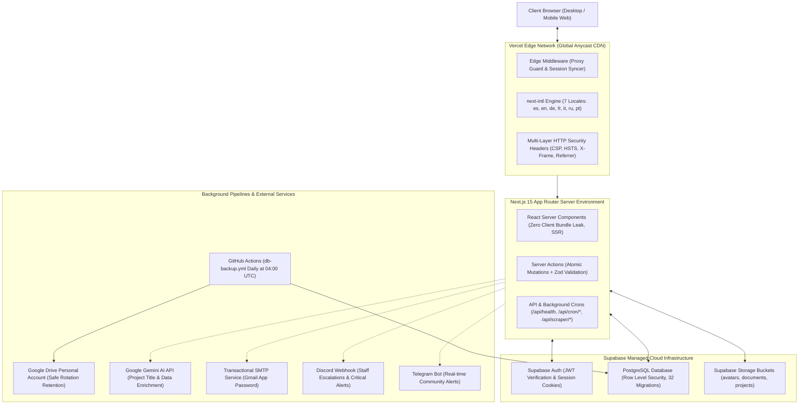
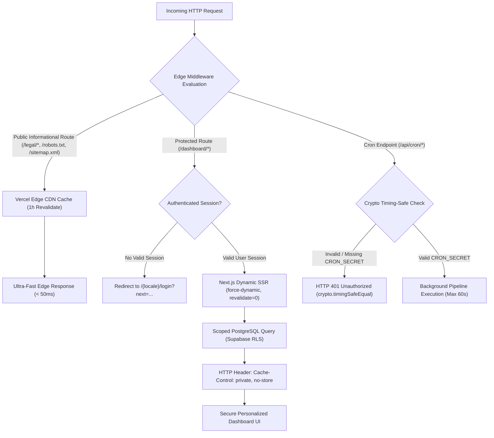

# EuroNova — Visual Architecture, Zero-to-Hero Deployment Guide & Dependency Matrix

**Version:** 1.0.0 — Master Handover & Operations Guide  
**Author:** Principal Software Architect & Technical Documentation Lead  
**Date:** November 2026  
**Reference Environment:** Next.js 15 (React 19), Supabase (PostgreSQL + RLS), Tailwind CSS v4, Vercel Anycast Edge  

---

## 1. System Architecture Diagrams (Mermaid.js)

### Diagram 1: High-Level System Topology

The following diagram details the comprehensive interaction between the client browser, Vercel Edge Network, Next.js 15 App Router server engine, Supabase managed infrastructure, cryptographic background crons, and Google Drive backups:



---

### Diagram 2: Request Lifecycle & Cache Segregation

Illustrates how Vercel and Next.js discriminate high-performance public cached routes versus authenticated routes shielded against cache poisoning:



---

## 2. Zero-to-Hero Installation & Deployment Guide

### 2.1 System Prerequisites
- **Node.js:** Version `20.x` or `22.x` (LTS recommended).
- **Package Manager:** `npm` (version 10+).
- **Git:** Installed on operating system.
- **PostgreSQL Client (`pg_dump`):** Required for local testing of backup script.
- **Supabase Account:** Active project on Supabase Cloud.

---

### 2.2 Step 1: Clone Repository & Install Dependencies
From your system terminal:

```bash
# 1. Clone the repository
git clone https://github.com/CRACKXXXX/EuroNova.git
cd EuroNova

# 2. Navigate to application root
cd euronova

# 3. Install dependencies using exact locked versions
npm ci
```

---

### 2.3 Step 2: Configure Environment Variables (`.env.local`)
Copy the sanitized environment template and populate your real credentials:

```bash
# Inside euronova/ directory
cp .env.example .env.local
```

Edit `.env.local` with your active keys:
- `NEXT_PUBLIC_SUPABASE_URL`: `https://<your-id>.supabase.co`
- `NEXT_PUBLIC_SUPABASE_ANON_KEY`: Public JWT token (Anon key).
- `SUPABASE_SERVICE_ROLE_KEY`: Administrative JWT token (Service Role key).
- `SUPABASE_DB_URL`: Direct PostgreSQL connection URI (Port 5432).
- `CRON_SECRET`: Random cryptographic secret string (>= 32 characters recommended).
- `NEXT_PUBLIC_SITE_URL`: `https://euronova.vercel.app` (or `http://localhost:3000` locally).

Validate your configuration before proceeding:
```bash
node scripts/validate-env.mjs
```
*Must report 0 critical failures (`Exit Code 0`).*

---

### 2.4 Step 3: Supabase Schema Initialization & SQL Migrations
The repository houses **32 idempotent SQL migration scripts** in `supabase/migrations/`.

1. Navigate to your [Supabase Dashboard](https://supabase.com/dashboard) > **SQL Editor**.
2. Sequentially run migration scripts from `00001_initial_schema.sql` through `99999999_production_zero_indexes_and_rls.sql`.
   - Alternatively, if you have the Supabase CLI installed:
     ```bash
     npx supabase db push
     ```

---

### 2.5 Step 4: Storage Bucket Creation & Configuration
The platform requires **3 storage buckets** in Supabase Storage:

1. **`avatars`** (Public):
   - Usage: User profile avatars and organization logos.
   - Size limit: 5 MB.
   - MIME types: `image/jpeg`, `image/png`, `image/webp`.
2. **`documents`** (Private / RLS-Governed):
   - Usage: PDF resumes/CVs, candidate dossiers, and NGO legal documentation.
   - Size limit: 20 MB.
   - MIME types: `application/pdf`, `image/jpeg`, `image/png`.
3. **`projects`** (Public):
   - Usage: Banners and illustrative media for European volunteer missions.
   - Size limit: 10 MB.
   - MIME types: `image/jpeg`, `image/png`, `image/webp`.

*Note:* Migration script `99999999_production_zero_indexes_and_rls.sql` automatically provisions these buckets and their associated RLS storage policies.

---

### 2.6 Step 5: Local Environment Execution
To launch the development server:

```bash
# Execute validations and launch Next.js dev server
npm run dev
```
Open your browser at: [http://localhost:3000](http://localhost:3000).

To compile and verify the exact production build locally:
```bash
# Strict production build and start
npm run build
npm run start
```

---

### 2.7 Step 6: Vercel Cloud Deployment (Critical Monorepo Configuration)

Because the repository houses the Next.js application inside the `euronova/` subdirectory:

1. Connect your GitHub repository `EuroNova` to Vercel.
2. In the import configuration screen or under **Project Settings > General**:
   - **Root Directory:** You MUST explicitly set:  
     👉 `euronova`
3. Under **Environment Variables**, configure all keys specified in `.env.example`:
   - `NEXT_PUBLIC_SUPABASE_URL`
   - `NEXT_PUBLIC_SUPABASE_ANON_KEY`
   - `SUPABASE_SERVICE_ROLE_KEY`
   - `CRON_SECRET`
   - `NEXT_PUBLIC_SITE_URL`
   - `EMAIL_USER` / `EMAIL_PASSWORD` (or SMTP credentials)
   - `GEMINI_API_KEY`
4. Click **Deploy**. Vercel will build using Webpack with 100% i18n parity across all 7 languages.

---

## 3. Dependency Version Lock Matrix

To preserve EuroNova's architectural stability, the following dependencies are under **strict upgrade locks** and **must not be updated without a formal architectural migration plan**:

| Package | Locked Version | Architectural Justification & Critical Regression Risk |
|---|---|---|
| **`react` / `react-dom`** | `19.2.8` *(Strictly Fixed)* | **Critical Hydration Risk:** Next.js 15 App Router relies internally on React 19's Server Components and Server Actions protocol. Upgrading outside this lock introduces hot-reload hydration mismatches, async hook context loss, and rendering crashes in `sonner` and `framer-motion`. |
| **`next`** | `^16.4.2` *(Next.js 15 / Webpack)* | **Cache & Proxy Regression Risk:** Governs dynamic vs static route cache segregation and proxy middleware conventions. Modifying without validation breaks hreflang compilation in `sitemap.ts` or alters `force-dynamic` behaviors. |
| **`next-intl`** | `^4.14.9` | **i18n Routing Breakage Risk:** Manages 7 locales (`es`, `en`, `de`, `fr`, `it`, `ru`, `pt`) and 2,138 keys per language. Major versions introduce breaking changes in `createNavigation` and locale detection middleware. |
| **`tailwindcss` & `@tailwindcss/postcss`** | `^4.0.0` *(Tailwind v4)* | **Cosmic Design System Risk:** EuroNova uses Tailwind v4's CSS-first architecture without `tailwind.config.js`. Incompatible PostCSS upgrades deactivate the cosmic palette (`void-deep`, `void-surface`, `plasma-cyan`, `hyper-violet`, `nova-flare`). |
| **`@radix-ui/react-tooltip`** | `^1.4.1` | **Tooltip Viewport Overflow Risk:** Powers collision detection and viewport awareness for `CosmicTooltip`. Incompatible versions trigger DOM portal flickering or clipping on sticky headers. |
| **`@supabase/ssr`** | `^0.12.7` | **Session Security Risk:** Controls defensive `httpOnly` cookie propagation across middleware, Server Components, and Server Actions. Contract mismatches in `getAll`/`setAll` cause infinite redirect loops to `/login`. |
| **`googleapis`** | `^189.0.0` | **Database Backup Pipeline Risk:** Utilized in `scripts/backup-db.mjs` for Service Account authentication with Google Drive and atomic Safe Rotation verification. |

---

## 4. Pre-Flight Quality Gates

Before merging code into `main` or deploying to production, all 4 automated blocking checks must be executed locally:

```bash
# 1. Environment and security validator
node scripts/validate-env.mjs

# 2. Strict i18n parity check (100% coverage across 7 languages)
node scripts/validate-i18n.mjs --strict

# 3. Strict TypeScript type check
npx tsc --noEmit

# 4. Clean code linter (0 errors, 0 warnings allowed)
npx eslint app components lib actions --max-warnings=0
```
