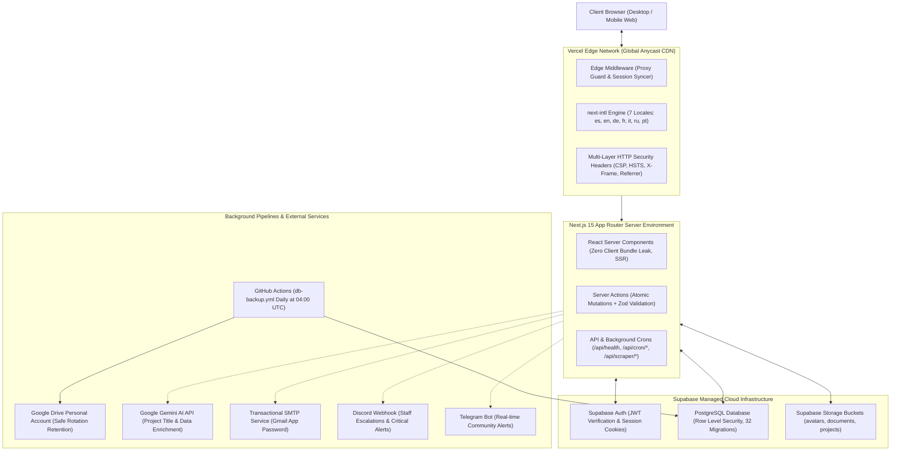
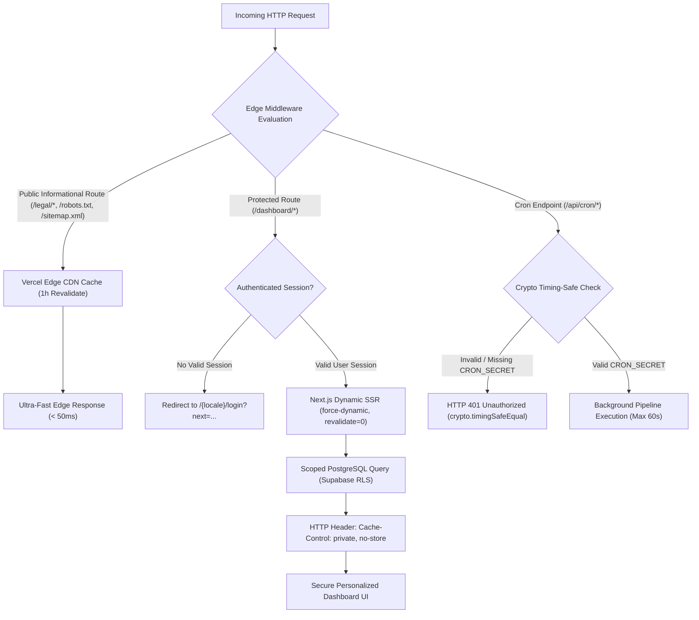

# EuroNova — Arquitectura Visual, Guía de Despliegue Zero-to-Hero & Matriz de Dependencias

**Versión:** 1.0.0 — Documento Maestro de Traspaso y Operaciones  
**Autor:** Principal Software Architect & Technical Documentation Lead  
**Fecha:** Noviembre 2026  
**Entorno de Referencia:** Next.js 15 (React 19), Supabase (PostgreSQL + RLS), Tailwind CSS v4, Vercel Anycast Edge  

---

## 1. Diagramas de Arquitectura del Sistema (Mermaid.js)

### Diagrama 1: Topología General del Sistema (High-Level System Topology)

El siguiente diagrama detalla la interacción integral entre el navegador del cliente, la red Edge de Vercel, el motor App Router de Next.js 15, la base de datos Supabase, los cron jobs criptográficos y los respaldos hacia Google Drive:



---

### Diagrama 2: Ciclo de Vida de Peticiones y Segregación de Caché (Request Lifecycle & Cache Segregation)

Muestra cómo Vercel y Next.js discriminan rutas públicas de alto rendimiento frente a rutas autenticadas protegidas contra envenenamiento de caché (*cache poisoning*):



---

## 2. Guía de Instalación y Despliegue Zero-to-Hero

### 2.1 Requisitos Previos del Sistema
- **Node.js:** Versión `20.x` o `22.x` (LTS recomendada).
- **Gestor de Paquetes:** `npm` (versión 10+).
- **Git:** Instalado en el sistema operativo.
- **PostgreSQL Client (`pg_dump`):** Requerido para pruebas locales del script de backup.
- **Cuenta de Supabase:** Proyecto creado en la plataforma de Supabase.

---

### 2.2 Paso 1: Clonar el Repositorio e Instalar Dependencias
Desde la terminal del sistema:

```bash
# 1. Clonar el repositorio
git clone https://github.com/CRACKXXXX/EuroNova.git
cd EuroNova

# 2. Navegar al directorio de la aplicación
cd euronova

# 3. Instalar dependencias con el candado exacto
npm ci
```

---

### 2.3 Paso 2: Configurar las Variables de Entorno (`.env.local`)
Copia la plantilla sanitizada y añade tus credenciales reales:

```bash
# Dentro de la carpeta euronova/
cp .env.example .env.local
```

Edita `.env.local` con tus claves reales:
- `NEXT_PUBLIC_SUPABASE_URL`: `https://<tu-id>.supabase.co`
- `NEXT_PUBLIC_SUPABASE_ANON_KEY`: Token JWT público (Anon).
- `SUPABASE_SERVICE_ROLE_KEY`: Token JWT de administración (Service Role).
- `SUPABASE_DB_URL`: URI de conexión directa de PostgreSQL (puerto 5432).
- `CRON_SECRET`: Cadena criptográfica aleatoria de al menos 32 caracteres.
- `NEXT_PUBLIC_SITE_URL`: `https://euronova.vercel.app` (o tu dominio local `http://localhost:3000`).

Valida tu configuración antes de continuar ejecutando:
```bash
node scripts/validate-env.mjs
```
*Debe reportar 0 errores críticos (`Exit Code 0`).*

---

### 2.4 Paso 3: Inicialización del Esquema y Migraciones de Supabase
El repositorio contiene **32 scripts de migración SQL** idempotentes en `supabase/migrations/`.

1. Accede a tu panel en [Supabase Dashboard](https://supabase.com/dashboard) > **SQL Editor**.
2. Ejecuta secuencialmente los scripts de migración desde `00001_initial_schema.sql` hasta `99999999_production_zero_indexes_and_rls.sql`.
   - Alternativamente, si tienes instalado Supabase CLI:
     ```bash
     npx supabase db push
     ```

---

### 2.5 Paso 4: Creación y Configuración de Buckets de Storage
La plataforma requiere **3 buckets de almacenamiento** en Supabase Storage:

1. **`avatars`** (Público):
   - Uso: Fotos de perfil de usuarios jóvenes y logos de organizaciones.
   - Tamaño máximo: 5 MB.
   - Tipos MIME: `image/jpeg`, `image/png`, `image/webp`.
2. **`documents`** (Privado / Con RLS):
   - Uso: CVs en PDF, expedientes de postulación (*dossiers*), documentación legal de ONGs.
   - Tamaño máximo: 20 MB.
   - Tipos MIME: `application/pdf`, `image/jpeg`, `image/png`.
3. **`projects`** (Público):
   - Uso: Banners e imágenes ilustrativas de los voluntariados y proyectos europeos.
   - Tamaño máximo: 10 MB.
   - Tipos MIME: `image/jpeg`, `image/png`, `image/webp`.

*Nota:* El script de migración `99999999_production_zero_indexes_and_rls.sql` incluye la provisión automática e idempotente de las políticas y buckets principales.

---

### 2.6 Paso 5: Ejecución en Entorno Local
Para iniciar el servidor de desarrollo:

```bash
# Ejecutar validaciones y servidor de desarrollo
npm run dev
```
Abre en tu navegador: [http://localhost:3000](http://localhost:3000).

Para compilar y verificar el build idéntico a producción localmente:
```bash
# Compilación estricta y servidor de producción
npm run build
npm run start
```

---

### 2.7 Paso 6: Despliegue en Vercel (Configuración Crítica de Monorepo)

Debido a que el repositorio aloja el código Next.js en la subcarpeta `euronova/`:

1. Conecta tu repositorio de GitHub `EuroNova` en Vercel.
2. En la pantalla de importación o en **Project Settings > General**:
   - **Root Directory:** Establece obligatoriamente:  
     👉 `euronova`
3. En **Environment Variables**, añade todas las claves especificadas en `.env.example`:
   - `NEXT_PUBLIC_SUPABASE_URL`
   - `NEXT_PUBLIC_SUPABASE_ANON_KEY`
   - `SUPABASE_SERVICE_ROLE_KEY`
   - `CRON_SECRET`
   - `NEXT_PUBLIC_SITE_URL`
   - `EMAIL_USER` / `EMAIL_PASSWORD` (o SMTP)
   - `GEMINI_API_KEY`
4. Pulsa **Deploy**. Vercel compilará automáticamente utilizando Webpack con paridad del 100% de traducciones en los 7 idiomas.

---

## 3. Matriz de Bloqueo de Dependencias (Dependency Version Lock Matrix)

Para preservar la estabilidad arquitectónica de EuroNova, las siguientes dependencias tienen **restricción estricta de actualización** y **no deben ser modificadas sin un plan de migración formal**:

| Paquete | Versión Bloqueada | Justificación Arquitectónica y Riesgo Crítico si se Modifica |
|---|---|---|
| **`react` / `react-dom`** | `19.2.8` *(Fijada estrictamente)* | **Riesgo Crítico de Hidratación:** Next.js 15 App Router depende internamente del protocolo de Server Components y Server Actions de React 19. Modificar esta versión causa desajustes de hidratación en caliente, pérdida de contexto en hooks asíncronos y fallos de renderizado en `sonner` y `framer-motion`. |
| **`next`** | `^16.4.2` *(Next.js 15 / Webpack)* | **Riesgo de Regresión en Caché y Proxy:** Gestiona la segregación de caché de rutas dinámicas frente a estáticas y la convención de middleware proxy. Actualizarla sin validación puede romper la compilación de rutas hreflang en `sitemap.ts` o alterar el comportamiento de `force-dynamic`. |
| **`next-intl`** | `^4.14.9` | **Riesgo de Ruptura de Enrutamiento i18n:** Administra la matriz de 7 locales (`es`, `en`, `de`, `fr`, `it`, `ru`, `pt`) y 2,138 claves por idioma. Versiones mayores introducen cambios incompatibles en `createNavigation` y el middleware de detección de idioma. |
| **`tailwindcss` & `@tailwindcss/postcss`** | `^4.0.0` *(Tailwind v4)* | **Riesgo en el Sistema de Diseño Cósmico:** EuroNova utiliza la arquitectura CSS-first de Tailwind v4 sin `tailwind.config.js`. Actualizar PostCSS o plugins de Tailwind sin compatibilidad desactiva la paleta cósmica (`void-deep`, `void-surface`, `plasma-cyan`, `hyper-violet`, `nova-flare`). |
| **`@radix-ui/react-tooltip`** | `^1.4.1` | **Riesgo de Desbordamiento de Tooltips:** Proporciona los motores de detección de colisiones de pantalla (*Collision Detection* y *Viewport Awareness*) para el componente `CosmicTooltip`. Una versión divergente puede provocar parpadeo del portal DOM o corte visual en cabeceras fijas. |
| **`@supabase/ssr`** | `^0.12.7` | **Riesgo de Seguridad en Sesiones:** Controla la propagación defensiva de cookies `httpOnly` entre middleware, Server Components y Server Actions. Cambios en sus contratos de `getAll`/`setAll` provocan bucles de redirección infinita a `/login`. |
| **`googleapis`** | `^189.0.0` | **Riesgo en Copias de Seguridad:** Utilizado en `scripts/backup-db.mjs` para autenticarse con Service Accounts en Google Drive y ejecutar la rotación segura. |

---

## 4. Controles de Calidad Previos a Commit (Pre-Flight Quality Gates)

Antes de fusionar código en `main` o desplegar a producción, es obligatorio ejecutar localmente los 4 controles bloqueantes:

```bash
# 1. Validador de entorno y seguridad
node scripts/validate-env.mjs

# 2. Validador estricto de paridad de idiomas (100% de cobertura en los 7 idiomas)
node scripts/validate-i18n.mjs --strict

# 3. Chequeo estricto de tipado TypeScript
npx tsc --noEmit

# 4. Linter de código limpio (0 errores, 0 advertencias)
npx eslint app components lib actions --max-warnings=0
```

