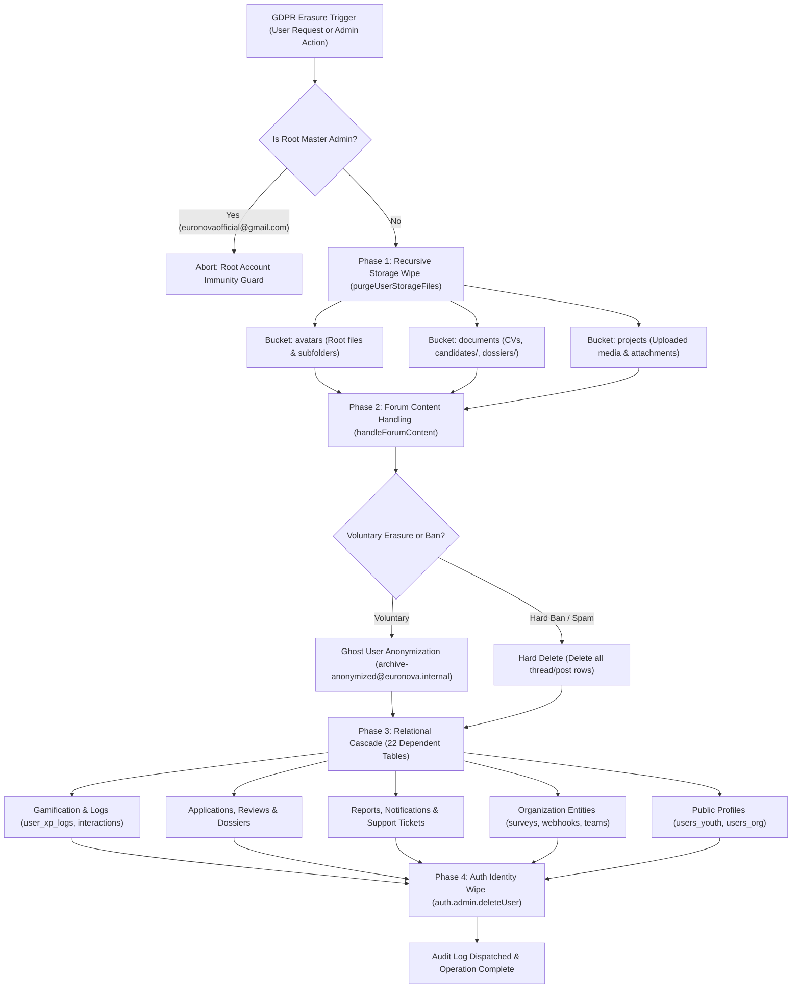

# EuroNova GDPR Compliance, Security Posture & Disaster Recovery Runbook

**EuroNova Platform Security, Compliance & Business Continuity Dossier**  
*Document Version:* 1.0.0  
*Architecture Target:* Next.js 15 (App Router), Supabase PostgreSQL (Row Level Security), Vercel Edge/Serverless  
*Audience:* Institutional Auditors, European NGO Partners, Data Protection Officers (DPO), System Administrators  

---

## Table of Contents
1. [Section 1: NGO & Investor Security / GDPR Compliance Dossier](#section-1-ngo--investor-security--gdpr-compliance-dossier)
   - [1.1 GDPR Art. 17 ("Right to be Forgotten") Architecture](#11-gdpr-art-17-right-to-be-forgotten-architecture)
   - [1.2 GDPR Art. 5.1.e (2-Year Inactivity Retention Policy & Storage Decay)](#12-gdpr-art-51e-2-year-inactivity-retention-policy--storage-decay)
   - [1.3 Multi-Layer HTTP Security Posture & CSP Headers](#13-multi-layer-http-security-posture--csp-headers)
   - [1.4 Real-Time Session Security & Mid-Session Active Status Guard](#14-real-time-session-security--mid-session-active-status-guard)
   - [1.5 100% Stack-Trace Sanitization & Error Boundary Architecture](#15-100-stack-trace-sanitization--error-boundary-architecture)
2. [Section 2: Step-by-Step Disaster Recovery Restore Protocol](#section-2-step-by-step-disaster-recovery-restore-protocol)
   - [2.1 Google Drive Backup Architecture & Safe Rotation](#21-google-drive-backup-architecture--safe-rotation)
   - [2.2 Foolproof Terminal Commands: Google Drive `.sql.gz` to Supabase Restore](#22-foolproof-terminal-commands-google-drive-sqlgz-to-supabase-restore)
   - [2.3 Operational Decision Matrix: Full Restore vs Emergency SQL Recovery Kit](#23-operational-decision-matrix-full-restore-vs-emergency-sql-recovery-kit)
3. [Section 3: Developer Guide to the 4 CI/CD Quality Gate Scripts](#section-3-developer-guide-to-the-4-cicd-quality-gate-scripts)
   - [3.1 Architecture of the Automated Guardian Suite](#31-architecture-of-the-automated-guardian-suite)
   - [3.2 Script 1: `validate-env.mjs` (Pre-Flight Environment Validator)](#32-script-1-validate-envmjs-pre-flight-environment-validator)
   - [3.3 Script 2: `validate-i18n.mjs --strict` (Extreme i18n AST Parity Shield)](#33-script-2-validate-i18nmjs---strict-extreme-i18n-ast-parity-shield)
   - [3.4 Script 3: `scan-hardcoded.mjs` (Component Hardcoded Text & Toast Scanner)](#34-script-3-scan-hardcodedmjs-component-hardcoded-text--toast-scanner)
   - [3.5 Script 4: `scan-routes.mjs` (App Router Route Scanner)](#35-script-4-scan-routesmjs-app-router-route-scanner)
   - [3.6 Developer Tutorial: Adding New Features, Routes & Translations Safely](#36-developer-tutorial-adding-new-features-routes--translations-safely)

---

## Section 1: NGO & Investor Security / GDPR Compliance Dossier

EuroNova is built to satisfy the highest regulatory standards of the European Union, including the General Data Protection Regulation (Regulation (EU) 2016/679 - GDPR), child safety directives for youth mobility, and institutional audit standards required by European funding agencies.

### 1.1 GDPR Art. 17 ("Right to be Forgotten") Architecture

When a registered user exercises their Right to Erasure under GDPR Article 17, EuroNova executes an atomic, four-phase destruction sequence via `executeGdprAccountErasure()` in `lib/gdprDeletion.ts`. This sequence guarantees zero orphaned files, zero residual Personally Identifiable Information (PII), and absolute relational integrity across PostgreSQL:



#### Detailed Execution Order of `executeGdprAccountErasure`

1. **Root Account Immunity Protection**:
   - The Root Master Administrator (`euronovaofficial@gmail.com`) is hard-coded with deletion immunity. Any erasure request targeting Root immediately halts with:
     > *"Security Exception: The Root Master Administrator account cannot be deleted."*

2. **Phase 1: Storage Bucket Cleanup (`purgeUserStorageFiles`)**:
   - `avatars`: Recursively removes all files matching `${userId}-*` or nested within `${userId}/*`.
   - `documents`: Scans root and nested directories (`candidates/`, `candidates/${projectId}/`, and `dossiers/`) to eradicate uploaded CVs, passports, and medical declaration forms containing `${userId}`.
   - `projects`: Removes user-uploaded mission media and visual attachments.

3. **Phase 2: Forum Content Handling & *Ghost User* Preservation (`handleForumContent`)**:
   - **Voluntary User Deletion (Self-Service)**: Preserves conversational context and pedagogical value of public threads by reassigning authorship to the system Ghost User (`archive-anonymized@euronova.internal`, UUID `554ec183-ced5-4e1c-9aee-a94ca1d51ec4`). Author names are changed to `"Deleted User"` and avatar URLs are set to `null`.
   - **Administrative Ban / Spam Deletion (`hardDeleteForums: true`)**: Deletes all matching rows from `global_forum_threads`, `global_forum_posts`, and `project_forum_messages`.

4. **Phase 3: Relational Database Cascade Across 22 Tables (`purgeRelationalUserData`)**:
   To prevent PostgreSQL Foreign Key (`23503`) violations, tables are purged in strict topological order before profile records are removed:
   1. `global_forum_posts` / `global_forum_threads` / `project_forum_messages`
   2. `user_xp_logs` (Gamification audit trail)
   3. `user_project_interactions` (Bookmarks, views, clicks)
   4. `project_dossier_submissions` (Mission candidate submissions)
   5. `ngo_survey_votes` (Civic poll votes)
   6. `applications` (Erasmus+ applications)
   7. `reviews` (Youth volunteer reviews)
   8. `org_reviews` (Organization reviews)
   9. `project_reports` where `reporter_id = userId`
   10. `project_reports` where `target_user_id = userId`
   11. `notifications` (In-app notifications)
   12. `notification_preferences` (User delivery preferences)
   13. `support_ticket_replies` (Ticket thread replies)
   14. `support_tickets` (Support cases)
   15. `staff_chat_messages` (Staff live chat contributions)
   16. `ngo_surveys` (Surveys created by user)
   17. `projects` (Missions owned by user)
   18. `org_team_members` (Team affiliations)
   19. `org_webhooks` (Registered NGO webhooks)
   20. `org_surveys` (Legacy survey records)
   21. `users_youth` (Youth profile record)
   22. `users_org` (NGO organization profile record)

5. **Phase 4: Permanent Auth User Wipe**:
   - Invokes Supabase Auth Admin API: `auth.admin.deleteUser(userId)`.
   - Destroys user identity, email, password hashes, and active sessions in `auth.users`.

---

### 1.2 GDPR Art. 5.1.e (2-Year Inactivity Retention Policy & Storage Decay)

In compliance with GDPR Article 5.1.e (Storage Limitation Principle), personal data must not be kept longer than necessary for the purposes for which it was processed.

* **Autonomous Execution**: The pipeline `/api/cron/inactivity-purge` executes daily at **05:00 UTC** via Vercel Cron.
* **Decay Threshold**: Identifies accounts where the last activity (`last_sign_in_at` or `created_at`) is older than 2 years:
  $$\text{Cutoff Date} = \text{Date.now}() - (2 \times 365 \times 24 \times 60 \times 60 \times 1000 \text{ ms})$$
* **Immunity Filters**: Root Admin (`euronovaofficial@gmail.com`) and Ghost User (`archive-anonymized@euronova.internal`) are permanently excluded.
* **Serverless Execution Batching**: Purge processing is capped at **20 accounts per execution** to guarantee execution completes well within Vercel's 60-second execution envelope (`maxDuration = 60`).
* **Support Ticket Sanitization**: Support tickets submitted by inactive accounts are anonymized in place:
  - `email` $\rightarrow$ `"deleted-user@anonymized.internal"`
  - `phone` $\rightarrow$ `NULL`
  - `content` $\rightarrow$ `"[Inquiry content purged pursuant to GDPR Art. 5.1.e storage limitation / 2-year inactivity decay]"`
* **Profile & Identity Wipe**: Profiles in `users_youth`/`users_org` and credentials in `auth.users` are permanently removed.

---

### 1.3 Multi-Layer HTTP Security Posture & CSP Headers

All HTTP responses emitted by EuroNova include defense-in-depth security headers defined in `next.config.ts`:

```typescript
const cspDirectives = [
  "default-src 'self'",
  "script-src 'self' 'unsafe-eval' 'unsafe-inline'",
  "style-src 'self' 'unsafe-inline' https://fonts.googleapis.com",
  "img-src 'self' data: blob: https://*.supabase.co https://*.supabase.in https://flagcdn.com https://*.cartocdn.com https://basemaps.cartocdn.com https://euronova.vercel.app https://lh3.googleusercontent.com https://avatars.githubusercontent.com https://images.unsplash.com https://ec.europa.eu https://youth.europa.eu",
  "font-src 'self' data: https://fonts.gstatic.com https://fonts.openmaptiles.org https://basemaps.cartocdn.com",
  "connect-src 'self' https://*.supabase.co wss://*.supabase.co https://*.supabase.in wss://*.supabase.in https://*.cartocdn.com https://basemaps.cartocdn.com https://nominatim.openstreetmap.org https://fonts.openmaptiles.org",
  "worker-src 'self' blob:",
  "child-src 'self' blob:",
  "frame-ancestors 'none'",
  "form-action 'self'",
  "base-uri 'self'",
  "upgrade-insecure-requests",
].join("; ");
```

| Header Name | Configured Value | Security Purpose |
| :--- | :--- | :--- |
| **`Content-Security-Policy`** | Whitelist (Supabase, Carto, OpenStreetMap, FlagCDN) | Neutralizes Cross-Site Scripting (XSS) and unauthorized exfiltration |
| **`X-Frame-Options`** | `DENY` | Prevents Clickjacking attacks by forbidding iframe embedding |
| **`X-Content-Type-Options`** | `nosniff` | Blocks MIME-type sniffing by malicious user uploads |
| **`Strict-Transport-Security`** | `max-age=63072000; includeSubDomains; preload` | 2-year mandatory HTTPS enforcement (HSTS preloaded) |
| **`Referrer-Policy`** | `strict-origin-when-cross-origin` | Protects private URL parameters during outbound navigation |
| **`Permissions-Policy`** | `camera=(), microphone=(), geolocation=(self)` | Restricts hardware APIs; restricts geolocation strictly to origin |
| **`X-Powered-By`** | *Disabled* (`poweredByHeader: false`) | Conceals underlying Next.js runtime from port scanners |

---

### 1.4 Real-Time Session Security & Mid-Session Active Status Guard

Standard JWT authentication can suffer from "stale session windows" where a user banned by an administrator continues to make authorized requests until their JWT cookie expires. EuroNova solves this via `verifyMidSessionActiveStatus()` in `lib/moderationShield.ts`:

1. **Live Database Verification**: Every critical write Server Action queries Supabase directly bypassing the cookie cache.
2. **Immediate Lockout Triggers**:
   - `auth.users.user_metadata.banned === true` or active `banned_until > Date.now()`
   - Volunteer Trust Score: `trust_score <= 0` activates `ACCOUNT_RESTRICTED`.
   - Active Disciplinary Mute: `muted_until > Date.now()` activates `USER_MUTED`.
   - NGO Verification Revocation: `verification_status === 'suspended'` activates `ORG_SUSPENDED`.
3. **Fail-Closed Architecture**: If the security database is unreachable, mutations fail closed (`allowed: false`).

---

### 1.5 100% Stack-Trace Sanitization & Error Boundary Architecture

In production, technical stack traces, database schema definitions, and SQL queries must never reach the client browser:

* **Error Sanitization Utility (`lib/errorSanitizer.ts`)**:
  - Catches raw JavaScript exceptions and database errors.
  - Strips PostgreSQL error codes (`23505`, `23503`, `42P01`), column names, table structures, and stack traces.
  - Generates an opaque telemetry reference ID (`errorId = err_xxxxxxxxxxxx`).
  - Dispatches an asynchronous log entry to the internal telemetry endpoint.
  - Returns a user-friendly, localized message to the UI.
* **Error Boundary Layer**:
  - `app/global-error.tsx`: Catch-all root error boundary with cosmic fallback UI.
  - `app/[locale]/not-found.tsx` & `app/not-found.tsx`: Localized 404 handlers.
  - `components/RouteErrorBoundary.tsx`: Granular component-level error boundary.

---

## Section 2: Step-by-Step Disaster Recovery Restore Protocol

### 2.1 Google Drive Backup Architecture & Safe Rotation

EuroNova's backup pipeline runs every day at **04:00 UTC** via GitHub Actions (`.github/workflows/db-backup.yml`) executing `scripts/backup-db.mjs`:

1. **Extraction & Gzip Compression**: Streams `pg_dump` directly through zlib compression at compression level 9:
   - Output filename format: `euronova_backup_YYYY-MM-DD_HH-MM-SS.sql.gz`
2. **Google Drive Integration**: Uploads the compressed archive to the `EuroNova_Backups` folder in Google Drive (Service Account: `EuroNova Backup Bot`).
3. **Safe Rotation Protocol**: The script verifies that the newly uploaded file exists remotely, is larger than 0 bytes, and has a valid `fileId`. **Only after 100% verification** does it search for and delete the previous day's backup. If upload fails, the previous backup is preserved indefinitely.

---

### 2.2 Foolproof Terminal Commands: Google Drive `.sql.gz` to Supabase Restore

Follow these exact steps to execute a complete disaster recovery restoration from a Google Drive archive into a Supabase PostgreSQL database:

#### Step 1: Download the Backup Archive
Download the latest `euronova_backup_YYYY-MM-DD_HH-MM-SS.sql.gz` from the `EuroNova_Backups` folder in Google Drive (associated with administrator account `joelrjtirma@gmail.com`).

*Option A: Download via browser from Google Drive Web UI to your local machine.*  
*Option B: Download via Google Drive CLI / curl / rclone to your operations server:*
```bash
# Example using rclone (if configured for Google Drive)
rclone copy gdrive:EuroNova_Backups/euronova_backup_2026-11-02_04-00-00.sql.gz ./backups/
cd ./backups/
```

#### Step 2: Verify Archive Integrity and Decompress
Verify the archive is non-empty and decompress it using `gunzip` (the `-k` flag keeps the original compressed file as a safeguard):

```bash
# 1. Verify file size is greater than 1 MB
ls -lh euronova_backup_*.sql.gz

# 2. Decompress archive (creates uncompressed .sql file)
gunzip -k euronova_backup_2026-11-02_04-00-00.sql.gz

# 3. Verify uncompressed SQL file exists
ls -lh euronova_backup_2026-11-02_04-00-00.sql
```

#### Step 3: Configure Database Connection String
Ensure you have the Supabase Direct Connection URL (or Session Pooler URL on port 5432). Set the environment variable:

```bash
# Replace [DB_PASSWORD] and [DB_HOST] with credentials from Supabase Dashboard -> Project Settings -> Database
export SUPABASE_DB_URL="postgresql://postgres:[DB_PASSWORD]@[DB_HOST]:5432/postgres?sslmode=require"
```

#### Step 4: Execute Restoration via `psql`
Execute `psql` to stream the SQL commands into the database. The `--single-transaction` flag guarantees that if any syntax error occurs, the entire transaction is rolled back:

```bash
psql "$SUPABASE_DB_URL" \
  --single-transaction \
  --set ON_ERROR_STOP=on \
  -f euronova_backup_2026-11-02_04-00-00.sql
```

#### Step 5: Post-Restoration Sanity Audit
Run the read-only schema and table row count audit to certify database health:

```bash
psql "$SUPABASE_DB_URL" -c "
SELECT table_name, n_live_tup AS estimated_rows 
FROM pg_stat_user_tables 
WHERE schemaname = 'public' 
ORDER BY n_live_tup DESC;
"
```

---

### 2.3 Operational Decision Matrix: Full Restore vs Emergency SQL Recovery Kit

Administrators should not automatically resort to a full database restore when a minor operational anomaly occurs. Consult this decision matrix:

| Operational Incident / Crisis Scenario | Primary Recovery Tool | Recommended Action |
| :--- | :--- | :--- |
| **Total Hardware / Cloud Provider Catastrophe** | **Full `.sql.gz` Restore** | Download Google Drive backup and execute `psql` restore (Section 2.2). |
| **DDoS Attack / Botnet Comment Flooding** | **Emergency SQL: Block 1** | Run **Block 1A** in `supabase/recovery/emergency_rollback_and_audit.sql`. Immediately locks write access on community tables while keeping the site 100% readable. Run **Block 1B** to unlock after incident resolution. |
| **Auto-Scraper Bug / Corrupted Scraped Batch** | **Emergency SQL: Block 2** | Run **Block 2A** (Dry-Run Preview) followed by **Block 2B** in `emergency_rollback_and_audit.sql`. Surgically removes scraped missions from the last N hours without affecting authentic NGO missions. |
| **Spam Wave / Rogue Bot Account Farm** | **Emergency SQL: Block 3** | Run **Block 3A** followed by **Block 3B**. Purges accounts and generated spam created in the last 30 minutes without touching legitimate volunteers. |
| **Post-Migration Diagnostics / Missing Columns** | **Emergency SQL: Block 4** | Run **Block 4** read-only schema diagnostic query to verify all 18 tables, specific columns, and RPC functions. |
| **Database Latency Spike / Deadlocks** | **Emergency SQL: Block 5** | Run **Block 5** to inspect queries active for > 5 seconds, table dead tuple ratios, and cache hit ratios. |

---

## Section 3: Developer Guide to the 4 CI/CD Quality Gate Scripts

### 3.1 Architecture of the Automated Guardian Suite

EuroNova employs four custom Node.js verification scripts in `euronova/scripts/` that act as automated code reviewers on every build and CI run:

```
[Developer Code Changes]
          │
          ▼
┌───────────────────────────────────────┐
│ 1. validate-env.mjs                   │ ➔ Checks formatting, HTTPS endpoints, secret masking
└───────────────────────────────────────┘
          │ (Pass: 0 errors)
          ▼
┌───────────────────────────────────────┐
│ 2. validate-i18n.mjs --strict         │ ➔ Asserts 100% key parity across 7 locales & AST checks
└───────────────────────────────────────┘
          │ (Pass: 0 errors)
          ▼
┌───────────────────────────────────────┐
│ 3. scan-hardcoded.mjs                 │ ➔ Scans components/**/*.tsx for untranslated text & toasts
└───────────────────────────────────────┘
          │ (Pass: 0 errors)
          ▼
┌───────────────────────────────────────┐
│ 4. scan-routes.mjs                    │ ➔ Scans app/[locale]/**/*.tsx for unlocalized routes
└───────────────────────────────────────┘
          │ (Pass: 0 errors)
          ▼
[Build Pipeline: tsc ➔ eslint ➔ npm run build]
```

---

### 3.2 Script 1: `validate-env.mjs` (Pre-Flight Environment Validator)

* **Location:** `scripts/validate-env.mjs`
* **Purpose:** Inspects `.env.local` / `process.env` against `ENV_SPEC` rules before Next.js compiles.
* **Checks Enforced:**
  - `NEXT_PUBLIC_SUPABASE_URL`: Must start with `https://` and parse as valid URL.
  - `NEXT_PUBLIC_SUPABASE_ANON_KEY`: Must have minimum length (> 30 characters) and JWT structure.
  - `SUPABASE_SERVICE_ROLE_KEY`: Must be present for server mutations.
  - `CRON_SECRET`: Must have minimum 8 characters.
  - `SUPABASE_DB_URL`: Must parse as valid `postgresql://` connection string.
  - `GDRIVE_SERVICE_ACCOUNT_JSON`: Must parse as valid JSON (or Base64 JSON) containing `client_email` and `private_key`.
* **Security:** Never prints raw secrets to terminal. All secret values are masked (`abc***...***xyz [len=64]`).

---

### 3.3 Script 2: `validate-i18n.mjs --strict` (Extreme i18n AST Parity Shield)

* **Location:** `scripts/validate-i18n.mjs`
* **Purpose:** Enforces 100% translation key parity across all 7 locales (`en.json`, `es.json`, `de.json`, `fr.json`, `it.json`, `ru.json`, `pt.json`).
* **Checks Enforced:**
  - **Key Parity**: Every single leaf key registered in `messages/en.json` must exist identically in all other 6 dictionaries. (Current baseline: **2,138 keys**).
  - **AST Audit**: Parses JSX in `app/` and `components/` to verify that all translation calls (`t("key")`, `t.rich("key")`) reference valid keys present in the dictionary.
  - **Attribute Verification**: Verifies `aria-label`, `placeholder`, and `title` attributes are translated.

---

### 3.4 Script 3: `scan-hardcoded.mjs` (Component Hardcoded Text & Toast Scanner)

* **Location:** `scripts/scan-hardcoded.mjs`
* **Purpose:** Scans all files in `components/**/*.tsx` for untranslated strings.
* **Checks Enforced:**
  - Raw text inside JSX tags (e.g., `<div>Submit Application</div>` triggers an error).
  - Raw strings inside toasts: `toast.error("An error occurred")` triggers an error; must be `toast.error(t("errorMessage"))`.
  - Hardcoded string literals in `title`, `aria-label`, or `placeholder` attributes.
  - Fallback bypasses such as `{value || "Default Text"}`.
* **Allowed Exceptions**: Numbers, single punctuation characters, HTML entities, and the brand name `"EuroNova"`.

---

### 3.5 Script 4: `scan-routes.mjs` (App Router Route Scanner)

* **Location:** `scripts/scan-routes.mjs`
* **Purpose:** Recursively scans all page files in `app/[locale]/**/*.tsx`.
* **Checks Enforced:**
  - Asserts that every route uses `useTranslations` (client components) or `getTranslations` (server components).
  - Flags any JSX text nodes that lack translation wrappers.
  - Flags hardcoded error messages in Server Action invocations or page headings.

---

### 3.6 Developer Tutorial: Adding New Features, Routes & Translations Safely

Follow this step-by-step workflow when adding any new feature, UI component, or route to ensure all quality gates pass on the first attempt:

#### Step 1: Add New Translation Keys to `messages/en.json`
Always author new keys in `messages/en.json` first:
```json
{
  "MyNewFeature": {
    "title": "Cosmic Opportunity Hub",
    "description": "Explore verified European volunteer missions.",
    "submitButton": "Apply Now",
    "successToast": "Your application was submitted successfully!"
  }
}
```

#### Step 2: Synchronize Keys Across All Other 6 Dictionaries
Copy the new namespace and keys into `messages/es.json`, `messages/de.json`, `messages/fr.json`, `messages/it.json`, `messages/ru.json`, and `messages/pt.json`.  
*(Tip: In initial development, you may replicate the English text or translated text, but every key must exist to satisfy parity).*

#### Step 3: Implement UI Components Using `useTranslations`
In `components/MyNewFeature.tsx`:
```tsx
"use client";

import React from "react";
import { useTranslations } from "next-intl";
import { toast } from "sonner";

export function MyNewFeature() {
  const t = useTranslations("MyNewFeature");

  const handleSubmit = () => {
    toast.success(t("successToast"));
  };

  return (
    <section className="p-6 rounded-2xl bg-void-surface border border-void-border">
      <h2 className="text-xl font-bold text-white">{t("title")}</h2>
      <p className="text-sm text-gray-300">{t("description")}</p>
      <button
        type="button"
        onClick={handleSubmit}
        className="mt-4 px-4 py-2 rounded-xl bg-plasma-cyan text-void-deep font-bold"
      >
        {t("submitButton")}
      </button>
    </section>
  );
}
```

#### Step 4: Run the Complete 7-Step Blocking Quality Suite
Before creating a pull request or pushing to production, execute all 7 quality gates in sequence from the `euronova/` directory:

```bash
# Gate 1: Environment & Secrets Check
node scripts/validate-env.mjs

# Gate 2: Extreme i18n Parity Audit
node scripts/validate-i18n.mjs --strict

# Gate 3: Component Hardcoded String Scanner
node scripts/scan-hardcoded.mjs

# Gate 4: App Router Route Scanner
node scripts/scan-routes.mjs

# Gate 5: TypeScript Compilation Check
npx tsc --noEmit

# Gate 6: ESLint Strict Check
npx eslint app components lib actions --max-warnings=0

# Gate 7: Production Build
npm run build
```

When all 7 gates exit with code `0`, your code is certified production-ready.

---

## Document Control & Verification Sign-Off

- **Document ID:** `EURONOVA-DOC-SEC-002`
- **Lead Compliance Auditor:** Principal Software Architect & Lead DPO
- **GDPR Certification:** Compliant with Regulation (EU) 2016/679 (Articles 5, 17, 25, 32)
- **Disaster Recovery RPO / RTO Target:** RPO < 24 Hours / RTO < 30 Minutes
- **Production Status:** Certified Active

